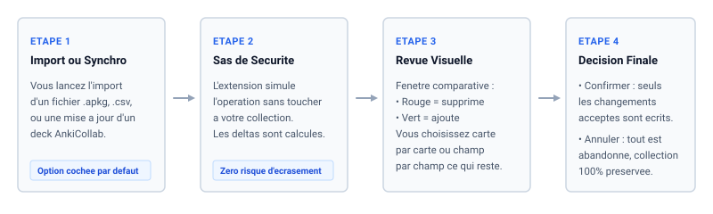
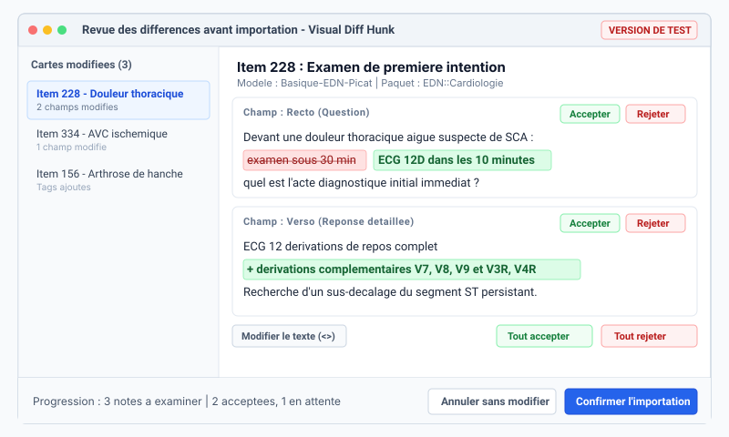

# Anki Import Diff Review & AnkiCollab History

Visualisez et validez chaque modification de vos flashcards avant de toucher a votre collection.

> [!CAUTION]
> **Avertissement - Version de Test Active**
> Cet add-on est en cours de developpement et d'experimentation. Il agit directement au moment de l'enregistrement de vos cartes.
> **Effectuez toujours une sauvegarde complete de votre profil Anki (export .colpkg avec medias) avant d'importer un paquet volumineux.**

---

## Le probleme resolu par Diff Hunk

Par defaut, lorsqu'on importe un fichier `.apkg` ou `.csv`, ou qu'on met a jour un paquet partage sur AnkiCollab, Anki applique les changements **a l'aveugle** :
- Vos notes personnelles peuvent etre effacees sans que vous ne le sachiez.
- Les reformulations ou suppressions passent inapercues.
- Il n'existe aucun moyen simple de refuser une modification sans tout annuler.

**Diff Hunk** insere un **sas de securite** avant l'import : il calcule les differences entre vos cartes actuelles et les cartes importees, vous les presente dans une interface claire, et vous laisse le choix carte par carte, champ par champ.

---

## Comment ca fonctionne ?

1. **Import ou Synchronisation :** Vous lancez normalement votre import de cartes ou votre mise a jour AnkiCollab.
2. **Sas de securite (Simulation) :** L'add-on intercepte l'operation et calcule les deltas dans un espace temporaire sans modifier votre collection.
3. **Revue visuelle comparative :** Une fenetre s'ouvre : ce qui est supprime apparait en **rouge barre**, ce qui est ajoute apparait en **vert**.
4. **Validation ou Annulation :** Vous choisissez ce que vous appliquez. Si vous annulez, votre collection reste strictement inchangee.

---

## Ce que vous voyez a l'ecran

- **Controle par champ :** Conservez par exemple la mise a jour de la question officielle mais refusez l'ecrasement de votre champ de notes personnelles.
- **Edition manuelle :** Possibilite de modifier le texte directement dans l'interface avant de l'enregistrer.
- **Volet lateral dans le navigateur (Parcourir) :** Suivi de l'historique de chaque carte et filtres rapides (*Champs modifies uniquement*, *Cartes deja apprises*).

---

## Risques encourus et regles de securite

1. **Validation hative :** Ne cliquez pas aveuglement sur "Tout accepter". Prenez le temps de survoler la liste des cartes modifiees.
2. **Synchronisation AnkiCollab :** Rejeter une modification officielle d'un deck collaboratif conservera votre version locale, mais AnkiCollab vous la reproposera lors de la prochaine synchronisation.
3. **Fermeture forcee d'Anki :** En cas d'arret inopine de votre ordinateur pendant la revue, executez `Outils > Verifier la base de donnees`.
4. **Sauvegarde obligatoire :** Faites un export de securite regulier via `Fichier > Exporter > Paquet de collection Anki (.colpkg)`.

---

## A propos & Credits

- **Auteur :** Ficello ([GitHub](https://github.com/Ficello))
- **Conception & Tests :** Architecture logicielle, hooks d'interception et couverture de tests concus avec **Antigravity** (Google DeepMind).
- **Depot Git :** [Ficello/Anki_Import_Diff_Review](https://github.com/Ficello/Anki_Import_Diff_Review)

---

## Compatibilite

- Anki 23.10+, Anki 24.x, Anki 25.x+
- Windows, macOS et Linux
- Prise en charge complete d'AnkiCollab (addon 1957538407)
